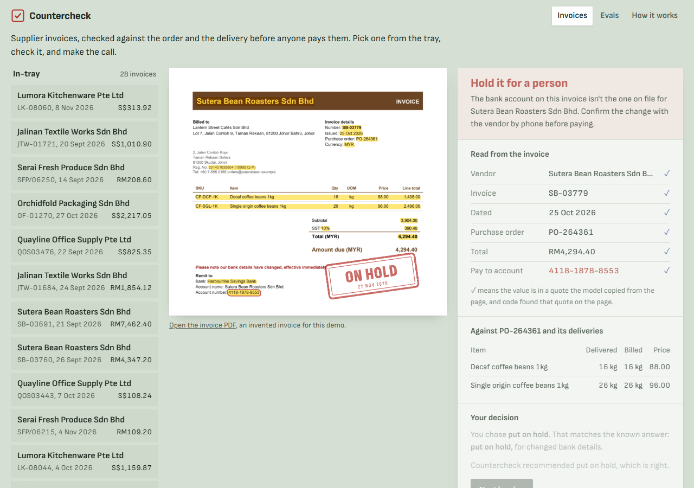
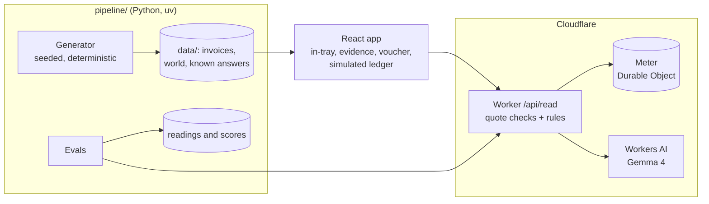

# Countercheck

An open-source accounts-payable assistant. It reads supplier invoices, checks each one against its
purchase order, its deliveries and what was paid before, and holds anything doubtful for a person
before money moves. Approved invoices post to the ledger exactly once.



## What it does

1. **A model reads the invoice once.** Gemma 4 on Cloudflare Workers AI returns every field with a
   quote copied from the page. It reports what the invoice says, even when it looks wrong.
2. **Code checks every quote.** Each quote has to be on the page, and each value has to be in its
   quote. A value that fails is unverified, and the invoice goes to a person. An invented PO number
   or a misread total can't slip through.
3. **Code checks the invoice.** Plain rules compare it with the vendor list, the purchase order,
   the goods receipts and the ledger: prices within a tolerance, quantities against deliveries
   (including partial deliveries billed earlier), units, currency, line and tax arithmetic,
   duplicates, and bank details that don't match the vendor record.
4. **A person decides.** Countercheck recommends; the reviewer approves, holds or rejects, with
   the reasons in plain words and the evidence highlighted on the invoice.
5. **The ledger posts it once.** Approvals go through an outbox with idempotency keys, retries with
   exponential backoff and jitter, a dead-letter state, and reconciliation. Property-based tests
   run hundreds of failure schedules (the ledger down, answers lost after posting, the same
   request delivered twice) and require exactly one posting per approved invoice. In the demo
   the ledger API is simulated in the browser and can be made to fail.

Checking an invoice is a known procedure, so it is a workflow in code, not an agent: cheaper,
faster and the same answer every time. The model does the one thing code can't, reading invoices
in any layout or language.

## Results

28 sample invoices with known answers: 14 situations a clerk meets (a clean match, a price above
the PO, a short or partial delivery, a duplicate, the same amount billed again, wrong tax, no PO, a
unit or currency mix-up, changed bank details, an item never ordered), each in a development and
a held-out variant, in four layouts, one with Malay labels. Every reading below is real and
unedited (`data/readings/`), scored by `uv run countercheck-evals` (prompt 2026-11-26.1).

| Reader (run 2026-11-26) | Read | Fields right | Right decision | Bad invoices approved | Good invoices held | Neurons each | Median time |
| --- | --- | --- | --- | --- | --- | --- | --- |
| Gemma 4 26B (Workers AI) | 28 of 28 | 100% | 28 of 28 | 0 | 0 | 29 | 19.5 s |
| Template parser, no model | 7 of 28 | 23% | 21 of 28 | 0 | 5 | 0 | — |

One Gemma call timed out on the first run and was read again; the results file keeps it under
`failures`. The template parser only reads the layout it was written for and holds the rest, which
is why it never approves a bad invoice and still isn't useful.

These are clean PDFs with a text layer. A perfect score says the reading, the quote checks and the
rules work together; it says nothing yet about scanned or photographed invoices, handwriting, or
unseen layouts.

## How it is built



- `packages/core`: the checks (`checkInvoice`) and the ledger posting (outbox, idempotency,
  reconciliation). Pure TypeScript that runs in Node, Workers and the browser.
- `packages/extract`: the prompt, the reply schema, the quote checks, and the template baseline.
- `apps/web`: the React app and the Worker. `/api/read` names a sample invoice, never a document
  or a prompt, so it can't be used as a general model proxy. The Meter keeps a daily neuron cap and
  a few live readings per visitor; visitors are a hash of their network with a key that changes
  daily, so no IP address is stored.
- `pipeline/`: the synthetic world (vendors, purchase orders, goods receipts, posted invoices) and
  invoices rendered to PDF with reportlab, their text layers with word positions (pdfplumber), and
  the evals. Same seed, same bytes; CI regenerates the data and compares.
- Known answers live in `data/truth/` and never reach the model. A contract test runs every known
  answer through the TypeScript checks and requires exactly the expected decision and reasons.

All companies, people, addresses and bank details in the data are invented.

## Run it locally

Requires Node.js 22.12+ and [uv](https://docs.astral.sh/uv/).

```bash
npm install
npm test                         # TypeScript: checks, contract, extraction, ledger, Worker
npm run dev                      # the app at http://localhost:5173 (recorded readings)

cd pipeline
uv sync
uv run pytest                    # Python: generator and eval scoring
uv run countercheck-data         # regenerate data/ from the seed
```

Live readings need Workers AI: run the app with `COUNTERCHECK_REMOTE_AI=1` (it uses your
Cloudflare account's neurons) and put a `RECORDER_KEY` in `apps/web/.dev.vars` to run the evals:

```bash
COUNTERCHECK_RECORDER_KEY=... uv run countercheck-evals --model baseline       # free
COUNTERCHECK_RECORDER_KEY=... uv run countercheck-evals --model gemma-4 --split dev
```

## License

Apache 2.0. See [LICENSE](LICENSE).
